  

### 👋 Hey there

Frontend Developer at **neop**, shipping production apps with **Vue.js & Nuxt.js**.
I like real-time systems, fast SSR, and smooth animations. I also mentor **150+ developers**, make technical videos on **YouTube**, and build open-source **AI dev tools**.

  

### 🧰 Toolbox

  

  

